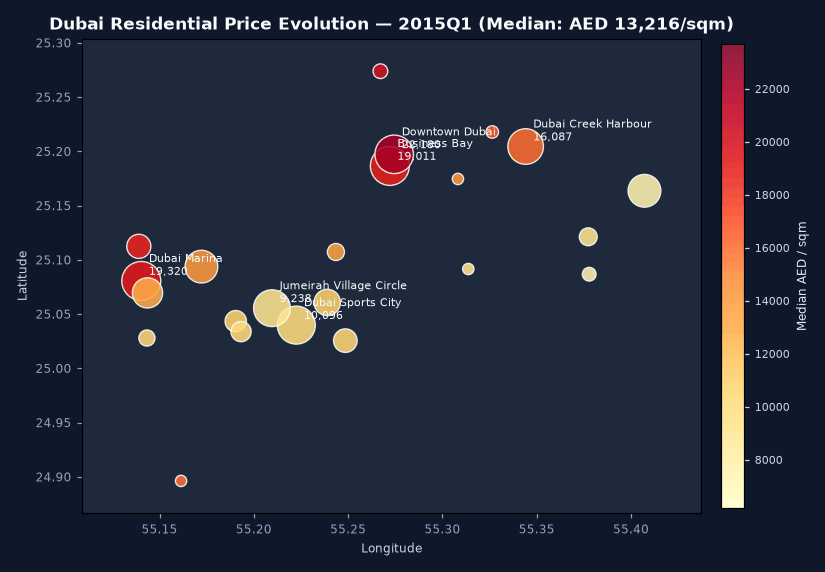
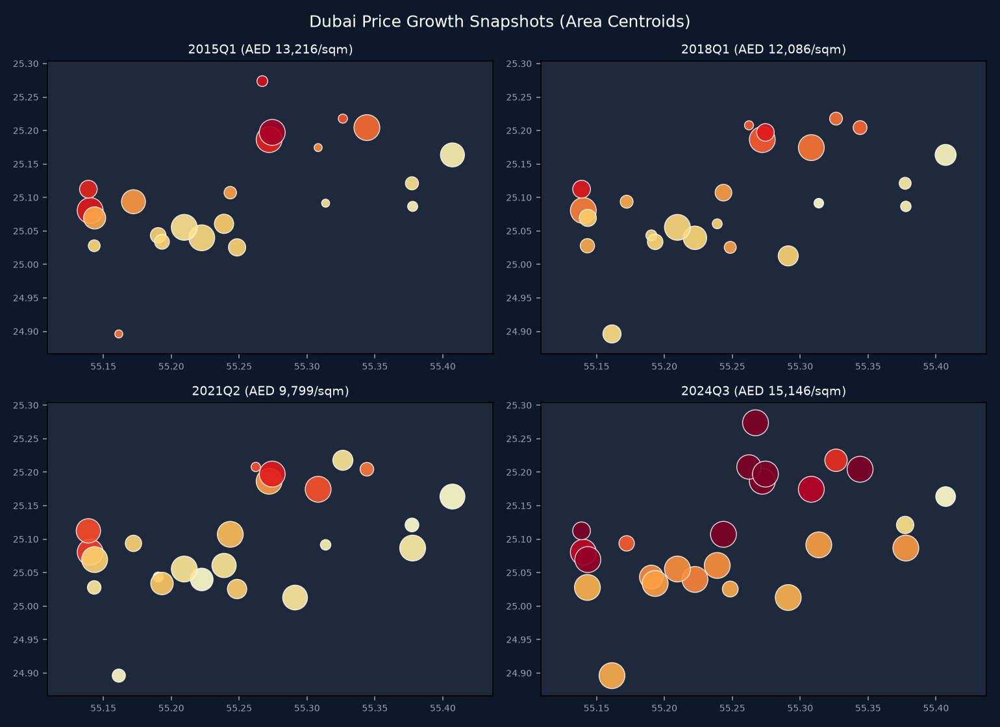
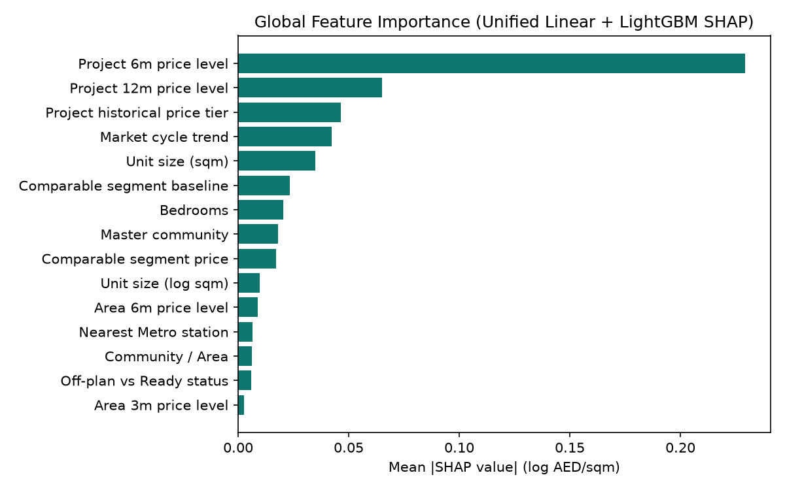
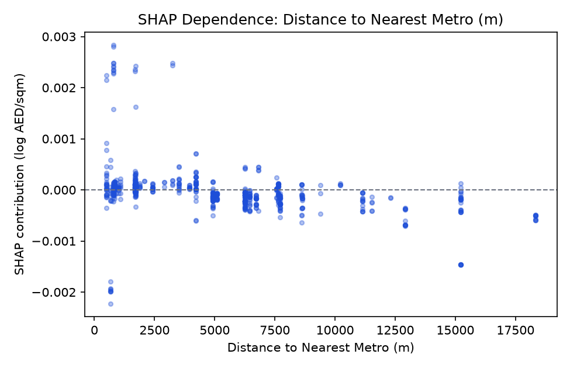

# DubaiFairValue

[](https://github.com/ANKARAHAMSA/Dubai-Fair-Value-Property/actions/workflows/ci.yml)
[](pyproject.toml)
[](reports/VERIFICATION_REPORT.md)


> **One-line pitch:** Submit any Dubai residential property's specifications and asking price to get an instant fair-value estimate, a calibrated 90% prediction interval, an objective verdict (`Underpriced` / `Fair` / `Overpriced` / `insufficient data`), and plain-English SHAP cost drivers backed by Dubai Land Department transaction data.

---

## Visual Preview



<details>
<summary>Static growth snapshots & global SHAP feature importance</summary>





</details>

---

## Run Locally in 3 Commands

Runs on macOS Apple Silicon (ARM64) and Linux with zero CUDA requirement and zero required API secrets:

```bash
make setup && make data && make app
```

- **Instant Sample Mode (clean clone, zero download)**: `DFV_DATA_MODE=sample make app` (runs against committed `data/sample/` + `ResidualBoostedLGBM` CI model).
- **Full Pipeline**: `make data features train analyze` ingests real public DLD extracts and builds `data/processed/` + tuned `LightGBM`.
- **REST API**: `make api` launches FastAPI with interactive OpenAPI docs at `http://127.0.0.1:8000/docs`.
- **Full Verification Gate**: `make verify` runs Ruff, Mypy, pytest (`83` tests, `89%` coverage), Pandera contracts, model gates, FastAPI latency checks, Streamlit `AppTest`, and all 5 Jupyter notebooks.

---

## Headline Measured Results

Evaluated strictly out-of-time on `459,145` unflagged DLD residential sales (`2015-01-01` to `2024-08-22`; test window `2024-02-23` -> `2024-08-22`, `70,608` held-out future transactions):

| Gate / Metric | Measured Result | Target / Notes |
| --- | --- | --- |
| **Primary Out-of-Time Test MdAPE** (`lightgbm_tuned`) | **`6.94%`** | Beats best baseline `baseline_ridge_log` (`9.50%`) by **`27.00%` relative** |
| **Nominal 90% CQR Interval Coverage** | **`89.93%`** | Gate `[85.0%, 95.0%]`; median relative width `43.75%` |
| **Spatial Unseen-Project Hold-Out MdAPE** | **`20.22%`** | `680` held-out projects (`88,057` rows) — degrades vs temporal test due to centroid fallback |
| **FastAPI `/predict` Warm Latency** | **`14.67 ms`** | Median over 5 warm calls (< 500 ms budget) |
| **CI / Sample Bundle Model (`data/sample/`)** | **`6.45%` MdAPE**, `91.67%` CQR cov | `ResidualBoostedLGBM` beats sample Ridge (`6.72%`); ADR-008 |
| **Verification Gate (`reports/VERIFICATION_REPORT.md`)** | **`PASS`** | `83` passed, `89%` coverage on `src/dfv`, zero skipped checks |

### Out-of-Time Baseline Comparison

| Model | Out-of-Time Test MdAPE | MAPE | Log RMSE | Log R^2 |
| --- | ---: | ---: | ---: | ---: |
| `baseline_global_median` | 33.32% | 35.20% | 0.5496 | -0.5899 |
| `baseline_trailing_12m_segment` | 13.07% | 20.01% | 0.2758 | 0.5995 |
| `baseline_ridge_log` | 9.50% | 13.05% | 0.1791 | 0.8312 |
| `ridge_residual_lightgbm` | 8.14% | 11.14% | 0.1555 | 0.8727 |
| **`lightgbm_tuned` (Primary)** | **6.94%** | 10.00% | 0.1454 | 0.8887 |

### Market Analysis Findings (Observational Associations)

- **Off-plan vs Ready Association**: `+28.27% (95% CI [27.99%, 28.55%], Area x Quarter FE)` across comparable properties (`+5.48%` within `Project x Quarter FE`, reflecting launch tiers and unobserved payment schedules).
- **Metro Proximity Rent Association**: Units within 500m show `+10.72% vs >= 2 km` in FE hedonic rent regressions (`Area x Quarter FE`). Route 2020 Two-Way FE DiD passes pre-trend checks with post-opening point estimate `-4.72%` (reflecting post-COVID/Expo structural shifts across outer vs core corridors and centroid fallback).
- **Best Yield per Risk Community (trailing 12m gross)**: `Jumeirah Village Circle (8.36% gross yield, risk 18.8)` (gross yield excludes service charges, vacancy, and closing fees).
- **Mix-Stratified Index vs DLD/Fallback Index**: `Pearson r = 0.9082 across 116 months (MAE 6.82 pts)`.

---

## What the Model Gets Wrong (Honest Error Analysis)

Transparency on failure modes is part of the design ([reports/error_analysis.md](reports/error_analysis.md)):

| Segment | Test Rows | MdAPE | 90% Interval Coverage |
| --- | ---: | ---: | ---: |
| All Test Transactions | 70,608 | 6.94% | 89.9% |
| Apartments (Unit) | 62,613 | 6.41% | 90.4% |
| Villas & Townhouses | 7,995 | 13.53% | 86.0% |
| Off-Plan Sales | 48,345 | 6.29% | 89.4% |
| Ready / Secondary Sales | 22,263 | 8.68% | 91.0% |
| Luxury (>= AED 5M) | 3,231 | 13.18% | 81.0% |
| Thin-Data Areas (<150 trailing sales) | 1,077 | 7.42% | 92.9% |

**Primary drivers of large errors (>200% outliers in luxury/secondary segments):**
1. **Unobserved unit attributes**: DLD public registries omit floor height, panoramic sea/Burj views, corner exposure, interior upgrades, and penthouse fit-outs.
2. **Spatial generalization to brand-new projects**: Holding out entire unseen buildings pushes MdAPE from `6.94%` to `20.22%` because the fallback dataset lacks per-building coordinates (`dld_projects-open` awaiting portal approval).
3. **Post-handover payment plans**: Developer-subsidized off-plan payment structures shift headline transaction prices without appearing in tabular features.
4. **Temporal drift across test window**: Monthly test MdAPE widens from `6.52%` (`2024-02`) to `7.74%` (`2024-08`) as market regime shifts accumulate.

---

## System Architecture

Full system architecture diagram and component specs live in [docs/architecture.md](docs/architecture.md).

- **Ingestion & Schema Adapter**: [src/dfv/data/](src/dfv/data/) (`schema.py`, `clean.py`, `validate.py`, `synth.py`, `download.py`).
- **Geo & Leakage-Safe Features**: [src/dfv/geo/](src/dfv/geo/) & [src/dfv/features/](src/dfv/features/) (`build.py`, `leakage.py` enforcing strict `< t` windows).
- **Modeling, CQR & SHAP**: [src/dfv/models/](src/dfv/models/) (Optuna LightGBM, split-conformal calibration, log-to-AED MVT SHAP decomposition, verdict confidence logic).
- **Econometric Market Analyses**: [src/dfv/analysis/](src/dfv/analysis/) + 5 executed notebooks in [notebooks/](notebooks/).
- **API & Guarded NL Search**: [src/dfv/api/](src/dfv/api/) + [src/dfv/search/](src/dfv/search/) (Pydantic v2 `PropertyFilters`, optional Anthropic/OpenAI JSON extraction with deterministic regex/fuzzy rules fallback, strictly parameterized DuckDB SQL).
- **10-Page Streamlit App**: [src/dfv/app/Home.py](src/dfv/app/Home.py) and [src/dfv/app/pages/](src/dfv/app/pages/).

### Engineering Build Phases (Phases 0–7)

Built strictly sequentially in eight gated milestones (`phase-0` through `phase-7`), where every phase passed `make verify` before moving forward:

| Phase | Focus | Key Modules & Deliverables | Verified Gate Outcome |
| --- | --- | --- | --- |
| **Phase 0** | Scaffold, Tooling & Synthetic Ground-Truth (`phase-0`) | `pyproject.toml`, `Makefile`, CI workflow, `src/dfv/verify.py`, planted-effect generator (`src/dfv/data/synth.py`), ADRs (`docs/DECISIONS.md`) | Tooling, lint, secret checks & synthetic test harness green |
| **Phase 1** | Schema-First Ingestion & Cleaning Contracts (`phase-1`) | Schema adapter (`schema.py`), Dubai Pulse/HF/GTFS downloader (`download.py`), deterministic cleaning (`clean.py`), Pandera schemas (`validate.py`), `docs/data_dictionary.md` | `1,276,960` -> `459,145` clean unflagged sales; all Pandera & Dubai ordering checks pass |
| **Phase 2** | Geospatial Enrichment & Leakage-Safe Features (`phase-2`) | Time-aware RTA Metro opening gating (`stations.py`), Nominatim SQLite cache + centroids (`geocode.py`), OSM POIs, strictly `< t` trailing windows & fold-strict OOF assertions (`build.py`, `leakage.py`) | Zero future/same-day leakage & zero unopened station leakage verified |
| **Phase 3** | Valuation Models, CQR Uncertainty & SHAP (`phase-3`) | 3 explicit baselines (`baseline.py`), Optuna LightGBM & small-sample `ResidualBoostedLGBM` (`train.py`, `hybrid.py`, `tune.py`), Split-CQR (`intervals.py`), MVT log-to-AED SHAP (`explain.py`), `verdict.py`, `registry.py` | Beat best baseline (`6.94%` vs `9.50%`), `89.93%` CQR coverage, spatial hold-out & failure report generated |
| **Phase 4** | Econometric Market Analyses & Notebooks (`phase-4`) | Off-plan vs ready FE, Metro FE + Route 2020 DiD + planted-effect test, Yield & Risk, Event ITS + official index check, Growth timelapse GIF + 5 executed notebooks | Planted effects recovered; all 5 `.ipynb` notebooks execute cleanly top-to-bottom |
| **Phase 5** | FastAPI REST API & Guarded NL Search (`phase-5`) | `/predict`, `/areas`, `/yield`, `/search`, `/health` (`api/main.py`), Pydantic v2 `PropertyFilters`, prompt-injection guardrails, rules fallback, parameterized DuckDB (`search/`) | API schema, 422 validation, warm `/predict` latency `< 500 ms`, mocked LLM & SQL safety pass |
| **Phase 6** | 10-Page Interactive Streamlit Dashboard (`phase-6`) | `Home.py` + 9 multipage analytics/valuation/map/NL-search screens (`app/pages/`), `sqm`/`sqft` toggle, explicit Sample vs Processed banners | Headless `AppTest` smoke tests pass across all pages on sample bundle |
| **Phase 7** | Skeptical Audit, Portfolio Docs & Cloud Packaging (`phase-7`) | Auto-rendered `README.md`, `data_card.md`, `model_card.md`, `architecture.md`, `interview_notes.md`, `linkedin_post.md`, `REVIEW_LOG.md`, `DEPLOY.md`, `Dockerfile`, `requirements.txt` | Clean-clone `DFV_DATA_MODE=sample` & processed `make verify` pass (`PASS`, `0` skipped checks) |

---

## Data Sources & Attribution

Official open data only; listing portals (Bayut, Property Finder, Dubizzle) are never scraped.

- **Transactions**: `unofficial_hf_fallback (viewit-ai/full-dubai-pulse)` — Dubai Land Department registry fields (unofficial Hugging Face convenience extract used where permission-gated Dubai Pulse CSV access is pending; `459,145` unflagged sales through `2024-08-22`).
- **Metro Stations**: `unofficial_mobilitydatabase_gtfs (mdb-904)` paired with official RTA Route 2020 opening dates in [data/reference/stations_opening.csv](data/reference/stations_opening.csv).
- **Rent Contracts, Projects & Official Index**: `synthetic_fallback` / `synthetic_fallback` / `synthetic_fallback` pending Dubai Pulse permission approval (`dld_rent_contracts-open`, `dld_projects-open`, `dld_residential_sale_index-open`).
- Full provenance, licensing notes, and cleaning attrition counts are documented in [docs/data_card.md](docs/data_card.md) and [docs/DATA_ACCESS.md](docs/DATA_ACCESS.md).

---

## Ethics, Uncertainty & Disclaimer

> **Not Financial or Appraisal Advice:** `DubaiFairValue` is an open-data machine learning & econometrics engineering project. Predicted ranges and verdicts reflect historical transaction patterns and statistical uncertainty; they do **not** replace RERA/RICS certified property valuations or licensed investment advice. Observational market analyses estimate statistical associations rather than isolated causal effects.

---

## Documentation & Deployment

- [Data Card](docs/data_card.md) & [Data Dictionary](docs/data_dictionary.md)
- [Model Card](docs/model_card.md) & [Architecture Decisions (ADRs)](docs/DECISIONS.md)
- [System Architecture (Mermaid)](docs/architecture.md)
- [Deployment Guide (Streamlit Community Cloud & Docker)](docs/DEPLOY.md)
- [LinkedIn Showcase Draft & Carousel](docs/linkedin_post.md)
- [UAE DS/ML Interview Prep Q&A (10 questions)](docs/interview_notes.md)
- [Independent Skeptical Review Log](docs/REVIEW_LOG.md)

---

## Repository Structure

```text
dubai-fair-value/
├── README.md                  # Auto-rendered from reports/*.json via `make render`
├── Makefile                   # setup, data, features, train, analyze, api, app, lint, test, verify, render
├── Dockerfile                 # Non-root python:3.12-slim API container
├── requirements.txt           # Exported runtime pins + `-e .` for Streamlit Cloud
├── packages.txt               # System `libgomp1` for Linux LightGBM
├── data/
│   ├── reference/             # Verified events.csv, stations_opening.csv, name_map.csv
│   └── sample/                # Committed CI bundle (features, sample models, analysis JSONs)
├── docs/                      # Cards, architecture, ADRs, deploy guide, LinkedIn, interview notes, review log
├── notebooks/                 # 5 executed Jupyter notebooks covering EDA & all 5 market analyses
├── reports/                   # VERIFICATION_REPORT.md, metrics.json, analysis_summary.json, figures/
├── src/dfv/                   # Core Python package (data, geo, features, models, analysis, search, api, app)
└── tests/                     # unit, property, data_contracts, integration, llm, api, app suites
```

---

## Roadmap

1. Swap `dld_rent_contracts-open`, `dld_projects-open`, and `dld_residential_sale_index-open` CSVs into `data/raw/` once Dubai Pulse portal approvals arrive and re-run `make data features train analyze verify`.
2. Add project/building-level Nominatim & Makani polygon geocoding with SQLite caching to narrow the unseen-project spatial hold-out gap.
3. Add scheduled monthly drift monitoring (`PSI` / rolling MdAPE alerting) and Dubai Blue Line Metro expansion event markers.
