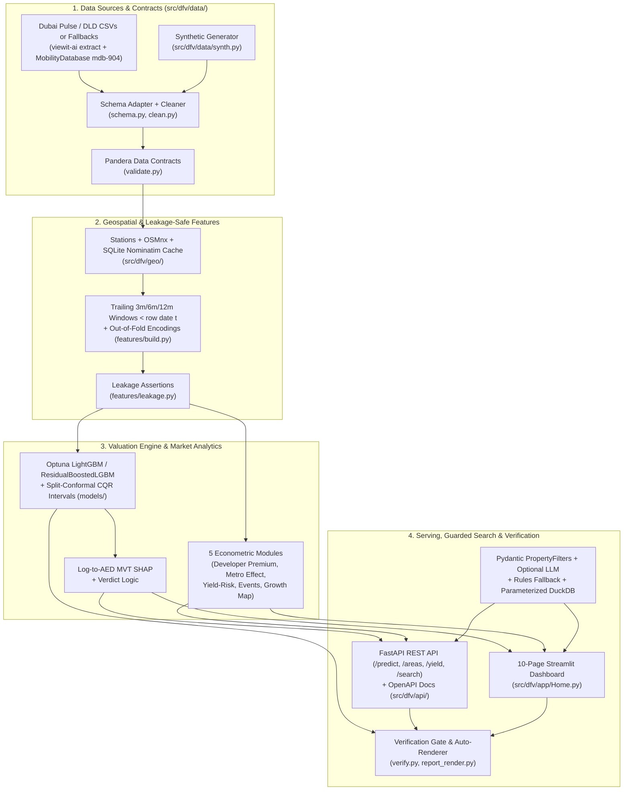

# System Architecture (`DubaiFairValue`)

`DubaiFairValue` separates data ingestion, geospatial enrichment, strictly leakage-safe temporal feature engineering, conformal LightGBM modeling, econometric market analytics, and user-facing serving (`FastAPI` + `Streamlit`) into modular, schema-tested layers under [`src/dfv/`](../src/dfv/).

## End-to-End Pipeline & Serving Diagram

## Layer Responsibilities

1. **Schema-First Ingestion ([`src/dfv/data/`](../src/dfv/data/))**
   - Reads manual CSV/Parquet files in `data/raw/`, optional Dubai Pulse Data API pulls, or explicit fallback extracts (`viewit-ai/full-dubai-pulse` transactions + MobilityDatabase `mdb-904` GTFS stations + `synthetic_fallback` for gated rents/projects/index).
   - Maps upstream portal column variants via `schema.py`, outputs `docs/data_dictionary.md`, logs rule-by-rule cleaning attrition into `reports/data_cleaning_report.md`, and enforces Pandera contracts (`validate.py`).
2. **Geospatial & Temporal Feature Store ([`src/dfv/geo/`](../src/dfv/geo/), [`src/dfv/features/`](../src/dfv/features/))**
   - Uses dataset proximity fields paired with curated RTA metro station coordinates/opening dates, cached OpenStreetMap landmarks, and area/project coordinates (rate-limited Nominatim cached in `data/cache/geocode.sqlite`, area centroids as fallback).
   - Computes trailing 3/6/12-month area, project, segment, and yield aggregates strictly from transactions prior to row `t` (`< instance_date`).
   - Enforces zero future leakage via automated invariant tests (`leakage.py`).
3. **Fair-Value & Uncertainty Engine ([`src/dfv/models/`](../src/dfv/models/))**
   - Evaluates against three explicit baselines (`baseline_global_median`, `baseline_trailing_12m_segment`, `baseline_ridge_log`) on strictly future temporal splits (`train -> val -> cal -> test`) plus rolling-origin CV and spatial unseen-project hold-out.
   - Calibrates raw quantile LightGBM `0.05` / `0.95` predictions via split-conformalized quantile regression (`CQR`) on the held-out calibration window.
   - Translates additive log-space SHAP attributions into AED via Mean Value Theorem scaling and runs metadata-validated serving (`registry.py`).
4. **Market Analytics ([`src/dfv/analysis/`](../src/dfv/analysis/))**
   - Modular econometric pipelines with HC1 robust standard errors, Frisch-Waugh-Lovell fixed-effects demeaning, additive two-way FE for Route 2020 DiD, and 5 executed Jupyter notebooks.
5. **REST API, Safe NL Search & Multi-Page App ([`src/dfv/api/`](../src/dfv/api/), [`src/dfv/search/`](../src/dfv/search/), [`src/dfv/app/`](../src/dfv/app/))**
   - Optional LLM integration extracts strictly validated Pydantic v2 `PropertyFilters` (`extra="forbid"`), retries once on invalid schema output, falls back to deterministic regex/fuzzy rules with no API key, rejects prompt-injection attempts, and executes parameterized DuckDB queries against Parquet without ever running LLM-generated SQL.
